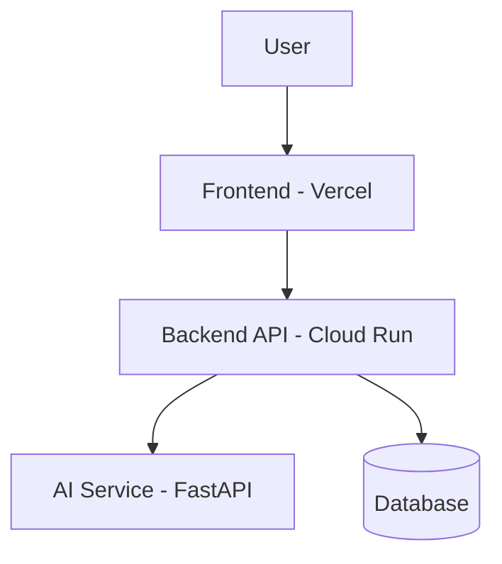

# SmartFlood V4 — Deployment Architecture

## Overview

This document describes the deployment architecture of SmartFlood V4, including its application components, hosting platforms, communication paths, and external dependencies.

The architecture must be verified against the repository configuration and deployed cloud resources before being treated as definitive.

## Deployment Topology

| Component   | Platform                                  | Responsibility                    | Verification Status   |
| ----------- | ----------------------------------------- | --------------------------------- | --------------------- |
| Frontend    | Vercel                                    | Serves the user interface         | Requires verification |
| Backend API | Google Cloud Run                          | Handles application API requests  | Requires verification |
| AI Service  | FastAPI; hosting platform to be confirmed | Provides AI-related functionality | Requires verification |
| Database    | Provider to be confirmed                  | Stores application data           | Requires verification |

## High-Level Architecture

The following diagram represents the current working hypothesis. Confirm the connections before treating it as the actual request flow.

The diagram assumes the backend API communicates with the AI service and database. These relationships must be confirmed from the application configuration and deployed resources.

## Component Responsibilities

### Frontend

The frontend provides the user interface and initiates requests to the backend API.

Items to verify:

- Hosting project and deployment URL.
- API base URL and runtime configuration.
- Authentication and authorization behavior.
- Whether browser requests communicate directly with the AI service.

### Backend API

The backend API handles application requests and coordinates access to supporting services.

Items to verify:

- Cloud Run service name and region.
- Container image and listening port.
- Health-check or readiness endpoint.
- Runtime environment variables and secret references.
- Database connection configuration.
- Whether it calls the FastAPI service.

### AI Service

The AI service uses FastAPI to expose AI-related application functionality.

Items to verify:

- Actual hosting platform and deployment status.
- Service URL and listening port.
- API endpoints consumed by the backend.
- Authentication between services.
- Model providers and external dependencies, if applicable.

### Database

The database persists application data.

Items to verify:

- Database engine and hosting provider.
- Connection method and network requirements.
- Authentication and secret storage.
- Backup and recovery arrangements.

## Networking and Trust Boundaries

Document the following after verification:

- Publicly accessible application endpoints.
- Private or authenticated service-to-service connections.
- IAM identities and permissions.
- Database network access restrictions.
- TLS usage and secret handling.

Do not assume that a service is private simply because it is hosted on Cloud Run. Verify its ingress configuration and invocation permissions.

## Architecture Decisions and Trade-offs

Record the reason for each confirmed decision, including:

- Why the frontend and backend use separate hosting platforms.
- Why the application uses separate API and AI services, if confirmed.
- How services authenticate to one another.
- How the architecture balances operational simplicity, security, reliability, and cost.

## Verification Evidence

For each component, record:

- Verification date.
- Resource name and hosting platform.
- Relevant repository configuration or cloud console evidence.
- Confirmed request paths and dependencies.
- Outstanding questions or discrepancies.

Do not include credentials, private keys, access tokens, or secret values.

## Related Documentation

- [Project Overview](./README.md)
- [Service Configurations](./services.md)
- [Configuration and Secrets](./configuration-and-secrets.md)
- [Security Review](./security.md)
- [Operations and Costs](./operations-and-costs.md)
- [Lessons Learned](./lessons-learned.md)

## Status

**Status:** Initial draft; deployment topology and service communication paths require verification.
